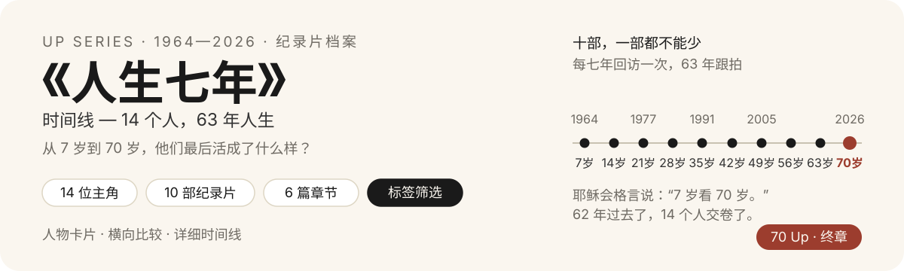

<p align="right"><a href="README.md">中文</a></p>

<p align="center">
  
</p>

<p align="center">
  <a href="https://xiaosang.cc/up-series-70years/">▶ Visit the Archive</a>
  ·
  <a href="https://github.com/holynova/up-series-70years">GitHub Repository</a>
</p>

Up Series 70 Years is a complete archive of the British documentary *Up Series*, tracing 14 lives across 63 years from age 7 to 70. It covers all 10 films, 14 character profiles, comparative social-mobility analysis and 6 long-form chapters. Pure static pages, with tag-based filtering and collapsible detailed timelines.

## Screenshot

<p align="center">
  
</p>

## The Ten Films

| Year | Film | Age |
| :---: | :--- | :---: |
| 1964 | Seven Up! | 7 |
| 1970 | 7 Plus Seven | 14 |
| 1977 | 21 Up | 21 |
| 1984 | 28 Up | 28 |
| 1991 | 35 Up | 35 |
| 1998 | 42 Up | 42 |
| 2005 | 49 Up | 49 |
| 2012 | 56 Up | 56 |
| 2019 | 63 Up | 63 |
| 2026 | 70 Up (finale, two 90-minute episodes on ITV1) | 70 |

## The Fourteen

The 14 participants, grouped by background: **the elite trio** (Andrew, Charles, John), **the three East End girls** (Jackie, Lynn, Sue), **the two children's home boys** (Paul, Symon), and six others including farm scientist Nick and would-be jockey Tony. Each has a card: portrait, tags, and a detailed timeline.

Filter instantly by tag: 精英家庭 (elite family) / 工薪阶层 (working class) / 儿童之家 (children's home) / 上大学 (went to university) / 没上大学 (no university) / 离婚 (divorced) / 再婚 (remarried) / 移民 (emigrated) / 心理健康问题 (mental health issues) / 已去世 (deceased) / 退出过节目 (left the show) / 有孙辈 (has grandchildren) / 退休 (retired).

## Chapters

6 long-form chapters (`chapters.html`):

- Chapter 1 · What *Up Series* Actually Is (origins, Apted taking over, all ten films, how the finale came about)
- Chapter 2 · Meeting the Fourteen (a quick introduction, group by group)
- Chapter 17 · The Fourteen Compared Side by Side (who matched the predictions, who surprised most, who is happiest, who has the most regrets…)
- Chapter 18 · Does British Class Really Decide a Life?
- Chapter 19 · Can Character at 7 Predict Age 70?
- Chapter 20 · Why in the End It's About More Than Class

## Run Locally

Zero build, zero dependencies — just open `index.html`:

```bash
open index.html
```

Or serve it statically:

```bash
python3 -m http.server 8000
# Open http://localhost:8000
```

## Tech

- Pure HTML + CSS + JS, zero dependencies, zero build; each of the three pages has its job, with data written directly into the pages.
- Character cards use `data-tags` for instant filtering; detailed timelines use native `<details>` collapsing, no framework.

```
index.html      Homepage: character cards + tag filters + ten-film timeline
person.html     Character detail page template
chapters.html   6 long-form chapters
avatars/        14 character portraits
```
