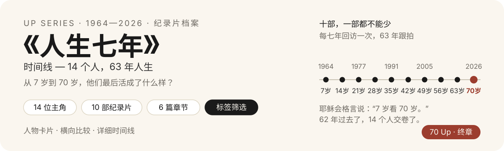

<p align="right"><a href="README.en.md">English</a></p>

<p align="center">
  
</p>

<p align="center">
  <a href="https://xiaosang.cc/up-series-70years/">▶ 在线浏览</a>
  ·
  <a href="https://github.com/holynova/up-series-70years">GitHub 仓库</a>
</p>

《人生七年》时间线是英国纪录片《Up Series》的完整档案：14 位主角从 7 岁到 70 岁的 63 年人生轨迹。包含全部 10 部纪录片纪事、14 张人物卡片、横向阶级变迁对比与 6 篇章节长文。纯静态原生网页，支持按标签即时筛选与详细时间线折叠浏览。

## 截图

<p align="center">
  
</p>

## 十部纪录片

| 年份 | 影片 | 年龄 |
| :---: | :--- | :---: |
| 1964 | Seven Up! | 7 岁 |
| 1970 | 7 Plus Seven | 14 岁 |
| 1977 | 21 Up | 21 岁 |
| 1984 | 28 Up | 28 岁 |
| 1991 | 35 Up | 35 岁 |
| 1998 | 42 Up | 42 岁 |
| 2005 | 49 Up | 49 岁 |
| 2012 | 56 Up | 56 岁 |
| 2019 | 63 Up | 63 岁 |
| 2026 | 70 Up（终章，两集各 90 分钟，ITV1 播出） | 70 岁 |

## 人物

14 位主角按出身分组：**精英三人组**（Andrew、Charles、John）、**东区三个女孩**（Jackie、Lynn、Sue）、**儿童之家的两个男孩**（Paul、Symon），以及农场科学家 Nick、骑师梦男孩 Tony 等六人。每人一张卡片：肖像、标签与详细时间线。

按标签即时筛选：精英家庭 / 工薪阶层 / 儿童之家 / 上大学 / 没上大学 / 离婚 / 再婚 / 移民 / 心理健康问题 / 已去世 / 退出过节目 / 有孙辈 / 退休。

## 章节

6 篇章节长文（`chapters.html`）：

- 第一章 · 《人生七年》到底是什么（来历、阿普特德接手、十部全览、终章由来）
- 第二章 · 14 个人快速认识（分组混脸熟）
- 第十七章 · 14 人人生横向比较（谁最符合预测、谁最出人意料、谁最幸福、谁最遗憾……）
- 第十八章 · 英国阶级真的决定人生吗
- 第十九章 · 7 岁的性格到底能不能预测 70 岁
- 第二十章 · 为什么最后不只是关于阶级

## 本地运行

零构建、零依赖，直接打开 `index.html`：

```bash
open index.html
```

或起一个静态服务器：

```bash
python3 -m http.server 8000
# 打开 http://localhost:8000
```

## 技术

- 纯 HTML + CSS + JS，零依赖、零构建；三个页面各司其职，数据直接写在页面里。
- 人物卡片用 `data-tags` 做即时筛选；详细时间线用原生 `<details>` 折叠，无框架。

```
index.html      首页：人物卡片 + 标签筛选 + 十部纪录片时间线
person.html     人物详情页模板
chapters.html   6 篇章节长文
avatars/        14 张人物肖像
```
